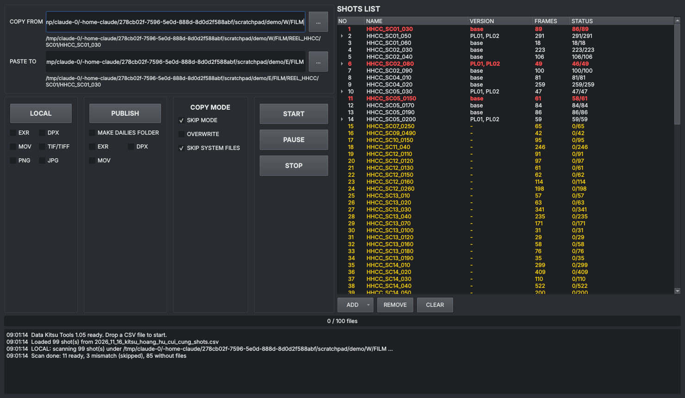

# Data Kitsu Tools

**English** | [Tiếng Việt](README.vi.md)

> Original idea: take the shot CSV from Kitsu, pick the shots, and sync their data from the network to local, and the reverse way for publish.

A tool that copies shot data for a Kitsu pipeline. It reads the shot list from a CSV exported from Kitsu, finds the shot folders (including sub folders), checks the frame counts, and copies them to the destination while keeping the source folder structure. Setup is simple, and it runs on **Windows, macOS and Linux**.



## Features

- **Read Kitsu CSV**: drag and drop, or click the *DROP CSV FILE* box, to load the shot list (the `Name` and `Frames` columns).
  Supports `;` or `,` separators, UTF-8, cp1258 (Vietnamese) and UTF-16.
- **Shots List**: shows NO, NAME, VERSION, FRAMES, STATUS. You can drag more shot folders or CSV files into the list while a copy is running.
  - Buttons under the list: **CLEAR** (empty the list), **ADD** (add a shot folder or type a shot name), **REMOVE** (remove the selected shots; Delete key works too).
  - Right-click a shot: **Open in Explorer**, **Copy path**, **Remove**.
- **Scan before copying**:
  - Finds the shot folders by name at any depth under COPY FROM.
  - Compares the real frame count with the Frames column. If they differ, the row turns red and the shot is skipped.
  - No files found: the row is yellow.
  - Hover over STATUS to see which frames are missing.
- **LOCAL**: copies shot folders and their variants (`PL01`, `PL02`, `PL03`...) and keeps the source folder structure. Variants appear as a tree you can collapse or expand, like in Explorer.
- **PUBLISH**: picks the highest version (`_v01` … `_v06` → `v06`) and copies it to `PASTE TO/<YYMMDD>/<folder name>`. Optional *MAKE DAILIES FOLDER* option.
- **File types filter**: EXR, DPX, MOV, TIF/TIFF, PNG, JPG (depends on the mode).
- **COPY MODE**: *SKIP* (keep existing files) or *OVERWRITE*. Optional skip of system files (`.DS_Store`, `._*`, `Thumbs.db`, `desktop.ini`).
- **START / PAUSE / STOP**: pause and resume are supported. On STOP, the file being copied is deleted and that shot is copied again with overwrite on the next START.
- **No half-written files**: data is written to `<name>.part` and renamed only when the copy is complete.
- **Progress**: an overall progress bar, and each shot's status changes colour as it goes.

### Status colours

| Colour | Meaning |
|---|---|
| Bold red | Frame count does not match the Frames column (shot is skipped) |
| Yellow | No files found after scan |
| Bold blue | Copying |
| Grey, italic, struck through | Copy finished |
| Orange | Stopped halfway (will overwrite on the next run) |

## Installation

Requirements: **Python 3.9 or newer** and **PySide6**.

The easiest way is to run the launcher. It checks Python, installs PySide6 if it is missing, and opens the app:

| OS | How to run |
|---|---|
| Windows | Double-click `run.cmd` (or `run.cmd --check` to only run the checks) |
| macOS | Double-click `run.command` (first time: right-click > Open, and `chmod +x run.command` if needed) |
| Linux | `./run.sh` (or `./run.sh --check`) |

Manual install if you prefer:

```bash
# Windows (PowerShell)
py -m pip install -r requirements.txt
py data_kitsu_tools.py

# macOS / Linux
python3 -m pip install -r requirements.txt
python3 data_kitsu_tools.py
```

## Quick start

1. Load the CSV with the *DROP CSV FILE* box.
2. Enter *COPY FROM* (source) and *PASTE TO* (destination). You can drag folders in from Explorer / Finder.
3. Click **LOCAL** or **PUBLISH** to scan. Check the colours and the STATUS column.
4. Click **START**, confirm, then follow the progress in the list and the log.

## Technical details

- Language: **Python 3** with a **Qt (PySide6)** GUI.
- Copies in 8 MB chunks, 4 files in parallel per shot, on a worker thread so the GUI does not freeze.
- Cache: no custom RAM cache, because the disk or network is the bottleneck. The OS already has a page cache; the app uses large buffers and parallel copies to make use of it.
- Paths use `pathlib`, so it works with `W:\...` on Windows and with `/Volumes/...` or `/mnt/...` on macOS and Linux.

### Compatibility

| OS | Status |
|---|---|
| Windows 10 / 11 | Supported (network drives and drive letters such as W: and E:) |
| macOS 12+ | Supported; ignores `._*` and `.DS_Store` files |
| Linux | Logic and GUI tested |

## Changelog

## My Modification update

- [26-11-18]
  - **Version 1.08:** scan matches folders with or without the reel tag (`HHCC_R1_SC04_020_Tom_comp_v03` now matches shot `HHCC_SC04_020`), so PUBLISH finds these shots instead of showing them as missing. Added a test for this.
  - **Version 1.07:** the copy log uses one line for the whole run; only its numbers change (e.g. `Copying HHCC_TLR_030 (17/42 file(s))`).
  - **Version 1.06:** the copy log shows one live line per shot, e.g. `Copying HHCC_TLR_030 (0/42 file(s))` counting up to `42/42`, and ends with `- done`.
  - **Version 1.05:** removed the left DROP CSV box; the empty SHOTS LIST now shows the drop / click hint instead. COPY FROM and PASTE TO fields are twice as tall to make drag and drop easier.
  - **Version 1.04:** shot list buttons ordered ADD / REMOVE / CLEAR, removing one shot no longer asks for confirmation, and Open in Explorer / Copy path now work for any shot (they find the folder when needed).
  - **Version 1.03:** COPY FROM / PASTE TO previews show the full path of the first shot (found in the background before a scan).
  - **Version 1.02:** Shot list buttons CLEAR / ADD / REMOVE, right-click menu (Open in Explorer, Copy path, Remove), and aligned mode and action buttons.
  - **Version 1.01:** versioning rule (same-day edits = 1.0N, next day = 1.1, then 1.1.N). Updater now compares versions in this order.
  - **Version 1.0:** first named version. Shown in the window title and in the `VERSION` file.
  - **Updater:** `updater.py` checks GitHub on each launch and shows an update notice. Answer `y` to update to the latest version from GitHub (git pull, or a zip download if the folder is not a git clone). Use `--no-update` to skip the check.
  - **English README:** added `README.en.md` and language links in both READMEs.
  - **Launchers:** added `run.cmd` (Windows), `run.sh` and `run.command` (Linux / macOS) to check Python, install PySide6 and open the GUI.
  - **Initial release:** GUI based on the mockup, reads Kitsu CSV, LOCAL / PUBLISH scan, copy with skip / overwrite, pause / resume / stop, skips system files, status colours, README.

## Updating

When a newer version is on GitHub, the launcher shows an *UPDATE AVAILABLE* notice. Answer `y` to update. The launcher then installs any new requirements and starts the new version.
