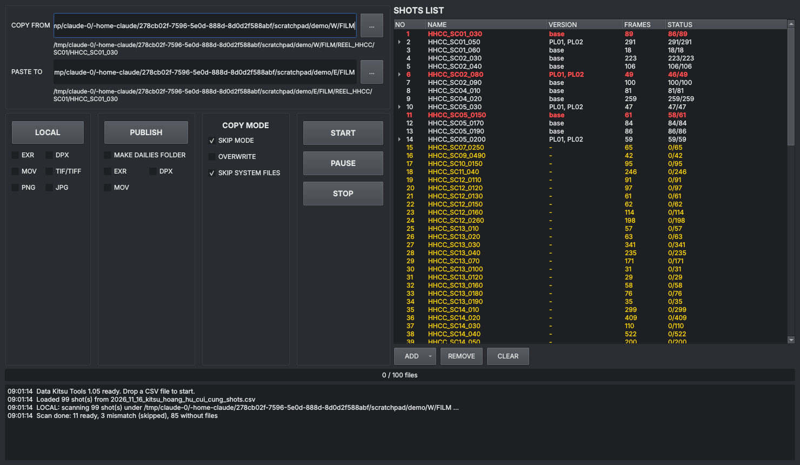

# Data Kitsu Tools

[English](README.md) | **Tiếng Việt**

> Ý tưởng gốc: lấy file CSV shot từ Kitsu, lấy các shot rồi đồng bộ data từ network về local, và chiều ngược lại để publish.

Công cụ copy data shot cho pipeline Kitsu: đọc danh sách shot từ file CSV xuất từ Kitsu,
tự tìm các folder shot (kể cả trong sub folder), kiểm tra số frame, rồi copy sang ổ đích
với đúng cấu trúc folder của nguồn. Không cần cài đặt phức tạp, chạy được trên **Windows, macOS và Linux**.



## Tính năng

- **Đọc CSV Kitsu**: kéo thả hoặc bấm vào khung *DROP CSV FILE* để nạp danh sách shot (cột `Name` và `Frames`).
  Hỗ trợ dấu `;` hoặc `,`, mã hóa UTF-8, cp1258 (tiếng Việt) và UTF-16.
- **Shots List**: hiển thị NO, NAME, VERSION, FRAMES, STATUS. Có thể kéo thả thêm folder shot hoặc file CSV mới vào danh sách trong lúc đang copy.
  - Nút dưới danh sách: **CLEAR** (xóa hết), **ADD** (thêm folder shot hoặc gõ tên shot), **REMOVE** (xóa shot đang chọn; phím Delete cũng được).
  - Chuột phải vào shot: **Open in Explorer**, **Copy path**, **Remove**.
- **Scan kiểm tra trước khi copy**:
  - Tìm folder theo tên shot ở mọi cấp sub folder của COPY FROM.
  - Số frame thực tế so với cột Frames. Lệch frame thì dòng chuyển đỏ và shot bị bỏ qua.
  - Không thấy file thì dòng màu vàng.
  - Rê chuột vào STATUS để xem frame nào bị thiếu.
- **LOCAL**: copy các folder shot và biến thể `PL01`, `PL02`, `PL03`... giữ nguyên cấu trúc thư mục nguồn.
  Các biến thể hiện dạng cây thu gọn / mở rộng như Explorer.
- **PUBLISH**: tự chọn version cao nhất (`_v01` … `_v06` → lấy `v06`) và copy vào
  `PASTE TO/<YYMMDD>/<tên folder>`. Có tùy chọn *MAKE DAILIES FOLDER*.
- **Lọc theo loại file**: EXR, DPX, MOV, TIF/TIFF, PNG, JPG (tùy mode).
- **COPY MODE**: *SKIP* (bỏ qua file đã có) hoặc *OVERWRITE* (ghi đè). Tùy chọn bỏ qua file hệ thống
  (`.DS_Store`, `._*`, `Thumbs.db`, `desktop.ini`).
- **START / PAUSE / STOP**: tạm dừng và tiếp tục được. Khi STOP, file đang copy dở sẽ bị xóa
  và shot đó được copy lại bằng chế độ ghi đè ở lần START sau.
- **Chống lỗi copy dở**: file được ghi vào `<tên>.part` và chỉ đổi tên khi đã copy xong.
- **Tiến độ**: thanh tiến độ tổng và trạng thái từng shot đổi màu theo tiến trình.

### Màu trạng thái

| Màu | Ý nghĩa |
|---|---|
| Đỏ đậm | Số frame không khớp với cột Frames (shot bị bỏ qua) |
| Vàng | Không tìm thấy file sau khi scan |
| Xanh dương đậm | Đang copy |
| Xám, nghiêng, gạch ngang | Đã copy xong |
| Cam | Đã dừng giữa chừng (sẽ ghi đè khi chạy lại) |

## Cài đặt

Cách nhanh nhất là chạy file launcher, nó tự kiểm tra Python, cài PySide6 nếu thiếu rồi mở app:

| Hệ điều hành | Cách chạy |
|---|---|
| Windows | Double-click `run.cmd` (hoặc `run.cmd --check` để chỉ kiểm tra) |
| macOS | Double-click `run.command` (lần đầu: chuột phải > Open, và `chmod +x run.command` nếu cần) |
| Linux | `./run.sh` (hoặc `./run.sh --check`) |

Cài thủ công nếu muốn:


Yêu cầu: **Python 3.9 trở lên** và **PySide6**.

```bash
# Windows (PowerShell)
py -m pip install -r requirements.txt
py data_kitsu_tools.py

# macOS / Linux
python3 -m pip install -r requirements.txt
python3 data_kitsu_tools.py
```

## Sử dụng nhanh

1. Nạp CSV bằng khung *DROP CSV FILE*.
2. Nhập *COPY FROM* (nguồn) và *PASTE TO* (đích). Có thể kéo thả folder từ Explorer / Finder.
3. Bấm **LOCAL** hoặc **PUBLISH** để scan. Kiểm tra màu và cột STATUS.
4. Bấm **START**, xác nhận, rồi theo dõi tiến độ trong danh sách và log.

## Tính năng kỹ thuật

- Ngôn ngữ: **Python 3** với giao diện **Qt (PySide6)**.
- Copy bằng khối 8 MB, copy song song 4 file mỗi shot, và thread riêng nên giao diện không bị đơ.
- Cache: không dùng RAM cache riêng vì ổ đĩa / mạng mới là nút thắt. Hệ điều hành đã có page cache,
  app dùng buffer lớn và copy song song để tận dụng nó.
- Đường dẫn dùng `pathlib` nên chạy đúng với `W:\...` trên Windows và `/Volumes/...`, `/mnt/...` trên macOS / Linux.

### Tương thích

| Hệ điều hành | Trạng thái |
|---|---|
| Windows 10 / 11 | Hỗ trợ (ổ mạng, ổ W:, E: đều được) |
| macOS 12+ | Hỗ trợ, bỏ qua file `._*` và `.DS_Store` |
| Linux | Đã kiểm thử logic và giao diện |

## Changelog

## My Modification update

- [26-11-18]
  - **Version 1.18:** dữ liệu lưu (log, lịch sử, thư mục run) được ghi vào thư mục `run_logs/` trong dự án để dễ dọn dẹp (thư mục này được git bỏ qua). Nếu không ghi được vào đó thì dùng thư mục dữ liệu riêng của người dùng.
  - **Version 1.17:** app tự lưu dữ liệu để phân tích sau (nút *Open log folder* trong cửa sổ INFO): `logs/app.log` (mọi dòng log, tự xoay vòng), `history.csv` (mỗi lượt chạy một dòng: thời gian, tốc độ, số luồng, lỗi, buffer, đường dẫn), và `runs/<giờ>/` gồm `samples.csv` (mỗi giây: MB/s, active time, số file, số luồng), `files.csv` (từng file: dung lượng, thời gian, MB/s, kết quả, lỗi) và `summary.json`. Giữ 100 thư mục run gần nhất.
  - **Version 1.16:** trước khi copy, app kiểm tra đích (có ghi được không, đủ dung lượng trống không, hiện dung lượng cần) và cảnh báo file nguồn rỗng, đường dẫn dài hơn 250 ký tự, file `.part` còn dở. Chặn copy nếu không đủ dung lượng. File đã có chỉ được bỏ qua khi size khớp; file bị cụt sẽ được copy lại. File được ghi xuống đĩa trước khi đổi tên. Thêm cài đặt **THREADS / SHOT** (1-16, mặc định 4) cho ổ mạng.
  - **Version 1.15:** các dòng log của shot vàng và đỏ (lý do và đường dẫn) được tô màu vàng hoặc đỏ để dễ theo dõi.
  - **Version 1.14:** nút About đổi tên thành **INFO**, đặt bên phải CLEAR. Cửa sổ About hiện chức danh (VFX Compositor), địa chỉ ví BSC kèm nút **Copy** (đổi thành *Copied*). COPY FROM và PASTE TO có nút ▾ liệt kê 10 đường dẫn gần nhất, dùng chung cho cả hai ô và được lưu cùng phiên làm việc.
  - **Version 1.13:** tiêu đề cửa sổ hiện tên tác giả (`Data Kitsu Tools 1.13 by Thomas Thinh Vu`). Nút **ABOUT ME** (góc dưới bên phải) mở cửa sổ có link liên hệ (ArtStation, LinkedIn, Facebook, Gmail) và mã QR donation đủ lớn để quét.
  - **Version 1.12:** hai ô thông số bên cạnh ADD / REMOVE / CLEAR hiển thị **active time** (% thời gian đĩa đang làm việc) và **tốc độ copy** (MB/s), có biểu đồ 60 giây. Shot đã có đủ file ở đích sẽ có màu vàng, cột version hiển thị phiên bản đang có ở đích kèm `-copied` (ví dụ `v02-copied`) và bị bỏ qua trừ khi bật OVERWRITE hoặc Force copy. Shot vàng và đỏ giờ ghi lý do và đường dẫn vào log, tooltip cũng hiện cùng lý do.
  - **Version 1.11:** shot đã bật **Force copy** hiển thị màu bình thường thay vì màu đỏ.
  - **Version 1.10:** chuột phải vào shot và chọn **Force copy** để copy shot có số frame khác số frame mong đợi. Các file đã có sẽ bị ghi đè. Bỏ tick để quay lại trạng thái bỏ qua shot.
  - **Version 1.09:** lưu cài đặt, shot list (kèm trạng thái done/partial) và log khi thoát và mỗi 20 giây, rồi khôi phục ở lần mở sau. Shot đang copy dở khi đóng app sẽ trở lại trạng thái partial và được copy lại với overwrite.
  - **Version 1.08:** scan khớp folder có hoặc không có nhãn reel (`HHCC_R1_SC04_020_Tom_comp_v03` khớp shot `HHCC_SC04_020`), nên PUBLISH tìm được các shot này thay vì báo thiếu. Đã thêm test cho việc này.
  - **Version 1.07:** log copy chỉ dùng một dòng cho cả lượt, chỉ thay đổi số (ví dụ `Copying HHCC_TLR_030 (17/42 file(s))`).
  - **Version 1.06:** log copy hiện một dòng cho mỗi shot được cập nhật trực tiếp, ví dụ `Copying HHCC_TLR_030 (0/42 file(s))` tăng dần tới `42/42`, rồi kết thúc bằng `- done`.
  - **Version 1.05:** bỏ khung DROP CSV bên trái; khi SHOTS LIST trống thì hiện hướng dẫn kéo thả / click ngay trong danh sách. Hai ô COPY FROM và PASTE TO cao gấp đôi để kéo thả dễ hơn.
  - **Version 1.04:** nút trong danh sách shot theo thứ tự ADD / REMOVE / CLEAR, xóa một shot không hỏi lại nữa, và Open in Explorer / Copy path đã hoạt động cho mọi shot (tự tìm folder khi cần).
  - **Version 1.03:** Ô xem trước COPY FROM / PASTE TO hiện full path của shot đầu tiên (tìm trong nền trước khi scan).
  - **Version 1.02:** Nút CLEAR / ADD / REMOVE trong danh sách shot, menu chuột phải (Open in Explorer, Copy path, Remove), và căn chỉnh lại các nút chế độ và nút điều khiển.
  - **Version 1.01:** quy tắc đánh số (cùng ngày = 1.0N, sang ngày mới = 1.1, sau đó 1.1.N). Updater so sánh phiên bản theo thứ tự này.
  - **Version 1.0:** phiên bản đặt tên đầu tiên. Hiện trên tiêu đề cửa sổ và trong file `VERSION`.
  - **Updater:** `updater.py` kiểm tra GitHub mỗi lần mở và hiện thông báo cập nhật. Trả lời `y` để cập nhật bản mới nhất từ GitHub (git pull, hoặc tải zip nếu thư mục không phải git clone). Dùng `--no-update` để bỏ qua kiểm tra.
  - **English README:** thêm `README.en.md` và link chuyển ngôn ngữ ở cả hai README.
  - **Launchers:** thêm `run.cmd` (Windows), `run.sh` và `run.command` (Linux / macOS) để kiểm tra Python, cài PySide6 và mở GUI.
  - **Initial release:** GUI theo mockup, đọc CSV Kitsu, scan LOCAL / PUBLISH, copy có skip / overwrite,
    pause / resume / stop, bỏ qua file hệ thống, màu trạng thái, README.

## Cập nhật

Khi có bản mới trên GitHub, launcher hiện thông báo *UPDATE AVAILABLE*. Trả lời `y` để cập nhật. Launcher sẽ cài các thư viện mới (nếu có) rồi mở phiên bản mới.
